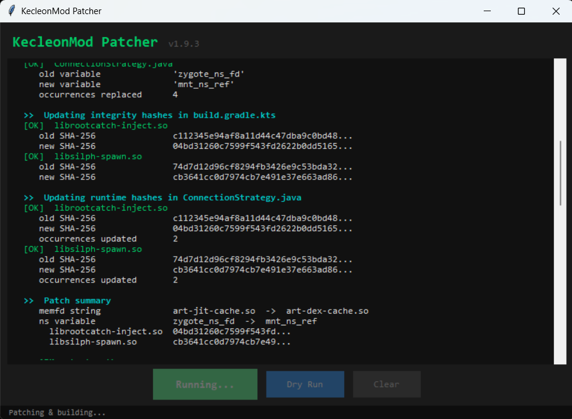

# KecleonMod

Private Pokémon GO automation for rooted Android (ARM64).
Built on SilphMod 1.9.3 as the base engine — catches, spins, research, transfers, and item cleanup, all from one APK.

---

## Version History

| Version | Date | Tag | Summary |
|---------|------|-----|---------|
| [1.0.6](#v106--anti-detection-patcher-14--delay-jitter--path-sync-fix) | 2026-10-22 | `v1.0.6` | 5 anti-detection patches, Patcher v1.4 (thread + path randomisation), delay jitter, AgentBuild path-sync architecture, engine path crash fixes. |
| [1.0.5](#v105--accordion-ui--throw-quality--spin-gyms--auto-save) | 2026-10-21 | `v1.0.5` | Accordion sections, multi-select throw quality, Curveball/AR Mode toggles, Spin Gyms, inline item management, settings auto-save. |
| [1.0.4](#v104--patcher-13--ui-redesign--new-engine-features) | 2026-10-21 | `Patcher 1.3 + UI + Engine Features` | Full KecleonMod UI redesign. Trainer name, separate spin/catch delays, Keep Nundo. Fixed LABEL crash in game-tools. |
| [1.0.3](#v103--patcher-12--bug-fixes) | 2026-10-21 | `Patcher 1.2 + Bug Fixes` | Patcher v1.2: 4 new anti-detection patches, app ID randomisation toggle. Fixed CRLF probe crash and hardcoded package name. |
| ~~1.0.2~~ | — | *(skipped)* | — |
| [1.0.1](#v101--patcher--anti-detection) | 2026-10-21 | `Patcher + Anti-Detection` | GUI patcher, randomised anti-detection strings, full SHA-256 sync, engine rebuild step. |
| [1.0.0](#v100--base-build) | 2026-10-21 | `Base Build` | Clean SilphMod 1.9.3 base. Fixed all injection bugs. First working build. |

---

## v1.0.6 — Anti-Detection + Patcher v1.4 + Delay Jitter + Path Sync Fix

**Date:** 2026-10-22
**Status:** Working
**APK:** `app-release.apk` (signed with debug keystore)

### Overview
5 hardcoded-string anti-detection patches applied, Patcher v1.4 now randomises thread names and agent asset paths each build, ±15% delay jitter added to all action timing, and a compile-time `AgentBuild` architecture introduced so every file that references the agent asset directory stays in sync automatically — eliminating the engine integrity and spawn-guard path crashes that appeared after the first patcher run.

---

### Anti-Detection Patches

#### 1. Thread Name Randomisation (Patcher v1.4)
Thread names are visible to any process that reads `/proc/<pid>/task/*/comm`. Two threads in `NativeEngineRunner` and one in `FarmService` were renamed from identifiable strings to generic Android-looking names. Patcher v1.4 rotates these from pools on every build so no fixed name persists across APK versions.

| Old name | New (example) | Location |
|---|---|---|
| `rootcatch-native-stop` | `async-task-3` | `NativeEngineRunner` stop thread |
| `rootcatch-native-reader` | `io-worker-1` | `NativeEngineRunner` reader thread |
| `rootcatch-farm` | `binder-pool-2` | `FarmService` farm thread |

#### 2. SharedPreferences File Rename
`/data/data/<pkg>/shared_prefs/rootcatch.xml` was a fingerprint-able filename. Renamed once to `app_config` — kept stable (not rotated per build) so user settings survive APK updates.

| Old filename | New filename |
|---|---|
| `rootcatch.xml` | `app_config.xml` |

#### 3. Agent Asset Path Randomisation (Patcher v1.4)
The agent JS bundle was at the Frida-standard path `engine/agent.js`. Patcher v1.4 now picks a random directory name from a pool (`opt`, `res`, `sys`, `lib`, `bin`, `cfg`, `var`) and a random filename (`service.bin`, `config.bin`, `runtime.bin`, `loader.bin`, `agent.bin`) on each build, moving the asset and updating all references.

#### 4. Delay Jitter (±15%)
All fixed action delays in `agent.ts` are now passed through a `jitter()` helper that applies ±15% random variation. This breaks fixed-interval timing signatures detectable by network traffic analysis.

```typescript
function jitter(ms: number): number {
    return Math.round(ms * (0.85 + Math.random() * 0.30));
}
```

Applied to: `actionDelayMs`, `spinDelayMs`, `catchDelayMs` (7 call sites).

#### 5. Notification String Genericisation
- Notification channel ID: `bg_service`, display name `"Background Service"` (was `"KecleonMod"`)
- Wake lock tag: `app:bg` (was `rootcatch:farm`)
- Notification title: removed `"KecleonMod · "` prefix — shows app name only
- Internal logs directory: `app-logs` (was `engine-logs`)

---

### Patcher v1.4

`tools/patch_build.py` now handles two new randomisation steps in addition to the existing three:

| Step | What it randomises | Pool size |
|---|---|---|
| Thread names | stop thread, reader thread, farm thread | 5 names each |
| Agent path | asset directory + filename | 7 dirs × 5 files |
| App ID | `applicationId` suffix | (unchanged from v1.3) |
| Version code | `versionCode` | (unchanged from v1.3) |
| Native hashes | `librootcatch-inject.so` SHA | (unchanged from v1.3) |

New reader functions: `read_thread_stop()`, `read_thread_reader()`, `read_thread_farm()`, `read_agent_dir()`, `read_agent_file()`. New patch steps: `step_patch_thread_names()`, `step_patch_agent_path()`.

---

### AgentBuild Path-Sync Architecture

**Problem:** After the first patcher run renamed `engine/agent.js` to `sys/config.bin`, three files still had `"engine/"` hardcoded and crashed at runtime:
- `FarmSession.java` → "Engine integrity check failed"
- `CompatibilitySession.java` → "ENGINE: ENGINE/SPAWN-GUARD.SH"
- `LogExporter.java` → asset-not-found on `injector.json`

**Solution:** `engine/build.cjs` now emits two additional constants into the generated `AgentBuild.java`:

```java
static final String SHA256 = "...";  // existed before
static final String PATH   = "lib/service.bin";   // new
static final String DIR    = "lib";                // new
```

`FarmPolicy` exposes `AGENT_PATH` and `AGENT_DIR` from these. Every file now reads `FarmPolicy.AGENT_DIR` instead of the literal `"engine"`. Because the value is baked in at compile time from whatever `build.cjs` just output, it is permanently immune to patcher renames — no patcher rule needed.

---

### Bug Fixes

| Fix | Root cause | Commit |
|---|---|---|
| "Engine integrity check failed" at startup | `FarmSession` opened `engine/agent.js` (old hardcoded path); post-rename the stale file had a different SHA than `AgentBuild.SHA256` | `a773f5d` |
| "ENGINE: ENGINE/SPAWN-GUARD.SH" error | `CompatibilitySession` and `LogExporter` had literal `"engine/"` prefixes the patcher never updated | `d9107dd` |

---

## v1.0.5 — Accordion UI + Throw Quality + Spin Gyms + Auto-Save

**Date:** 2026-10-21
**Status:** Working
**APK:** `app-release.apk` (signed with debug keystore)

### Overview
Major UI overhaul with 5 collapsible accordion sections, multi-select throw quality with random pick, Curveball and AR Mode toggles, confirmed Spin Gyms support, inline item management checkboxes, and a permanent fix for settings not saving on app pause.

---

### New Features

#### Collapsible Accordion Sections
The flat single-card layout is replaced with 5 independent collapsible sections. Tap a header to expand or collapse it. The last expanded/collapsed state is remembered per section.

| Section | Contents |
|---|---|
| **Catch Settings** | Catches toggle, Pokémon filter, throw quality checkboxes, Curveball, AR Mode, catch delay, max catches |
| **Spin Settings** | Spin PokéStops toggle, Spin Gyms toggle, spin delay, max spins |
| **Transfer Settings** | Transfer toggle + all keep-protection checkboxes |
| **Inventory Settings** | Berries, Show IV names, Extended manual transfer, Clean item bag + item rows |
| **Extra Settings** | Fast gift opening, Hide trainer name, Trainer name, Fix error 12, Remove buddy |

#### Multi-Select Throw Quality
The single throw quality button is replaced with 4 independent checkboxes: **Normal**, **Nice**, **Great**, **Excellent**. Any combination can be selected. When more than one is checked the engine picks one at random on each throw attempt. Defaults to Excellent only.

#### Curveball Toggle
Curveball was previously always on. It is now a checkbox in Catch Settings (default on). The `Spinning` field on `PokeballThrow` is set to `true`/`false` based on the toggle.

#### AR Mode Toggle
New checkbox in Catch Settings (default off). When on, sets `ExpertHandler = true` on `ARPlusEncounterValuesProto` to trigger the AR+ catch bonus. If the field name changes in a game update, the engine detects the failure on the first throw and shows a status bar warning instead of silently failing.

#### Spin Gyms
New toggle in Spin Settings. Uses a runtime probe to discover the IL2CPP method name for the gym fort list (tries 7 known candidate names; caches the first match). Gyms can be spun independently of PokéStops — both, either, or neither can be enabled. The engine calls `FortSearch` RPC 101 (same proto as PokéStops) once the method is found.

#### Inline Item Management
The "X item types" button that opened a dialog is replaced with inline checkboxes and keep-amount fields directly in the Inventory Settings section under the Clean item bag toggle. Items are grouped by category:

| Group | Items |
|---|---|
| Poké Balls | Poké Ball, Great Ball, Ultra Ball |
| Potions and revives | Potion, Super Potion, Hyper Potion, Max Potion, Revive, Max Revive |
| Berries | Razz Berry, Nanab Berry, Pinap Berry, Golden Razz Berry, Silver Pinap Berry |
| Evolution items | Sun Stone, King's Rock, Metal Coat, Dragon Scale, Up-Grade, Sinnoh Stone, Unova Stone |
| Technical Machines | Fast TM, Charged TM |
| Consumables | Lucky Egg, Star Piece, Poffin, Incense |
| Lure Modules | Lure Module, Glacial, Mossy, Magnetic, Rainy, Golden |

Each item has a checkbox (enable cleanup) and a number field (how many to keep). The amount field dims when the item is unchecked.

---

### Bugs Fixed

#### Settings Not Saving on App Pause
Previously `saveDraft()` (called on `onPause`) ran `saveSettings()` which validates before writing. Any validation failure — no throw quality checked, no items selected with clean on, no feature selected — threw an exception that was silently caught, so **nothing was written to SharedPreferences**. All boolean toggles and checkboxes were lost on every pause.

Fix: split into `persistSettings()` (always writes, no validation, treats invalid item amounts as 0) and `saveSettings()` (validates then calls `persistSettings()`). `saveDraft()` now calls `persistSettings()` directly.

#### AR Mode Silent Failure
AR Mode set `ExpertHandler` inside an empty `try/catch` — if the field was renamed in a game update the feature would stop working with no indication. Fixed to probe once on the first throw: success sets a cached flag so subsequent throws call it directly; failure emits `ar_mode_error` which surfaces as a status bar message and disables AR for the session.

#### Spin Gyms: "Select a feature" with Gyms Only
`FarmPolicy.validate()` did not count `spinGyms` as a standalone feature, so enabling only Spin Gyms blocked starting with "Select a feature". Fixed by adding `spinGyms` to the validation check.

#### Spin Gyms: Not Spinning When AutoSpin Was Off
The gym spin code was only reached if `config.autoSpin` was true. Fixed — the tick loop now gates on `config.autoSpin || config.spinGyms`, and the PokéStop fetch is guarded by `config.autoSpin` so it is skipped when only gyms are enabled.

---

### Files Changed

| File | Change |
|---|---|
| `app/src/main/java/dev/rootcatch/ugphone/MainActivity.java` | Accordion layout; throw quality checkboxes; inline item rows; persistSettings() split |
| `app/src/main/java/dev/rootcatch/automation/AutomationConfig.java` | `throwQualities` list, `curveball`, `arMode`, `spinGyms`, `spinDelayMs`, `catchDelayMs` fields |
| `app/src/main/java/dev/rootcatch/nativeengine/NativeEngineRunner.java` | `throwQualities` JSONArray, `curveball`, `arMode`, `spinGyms` params; `ar_mode_error` event handler |
| `app/src/main/java/dev/rootcatch/ugphone/FarmSession.java` | `throwQualities`, `curveball`, `arMode`, `spinGyms` in session record |
| `app/src/main/java/dev/rootcatch/ugphone/FarmPolicy.java` | `spinGyms` param added to `validate()` |
| `engine/src/agent.ts` | Multi-quality throw pick; curveball field; AR mode probe-once; gym method probe + spin; separate spin/catch delay timers |
| `engine/src/throw-profile.cjs` | New `pick(qualities[])` function for random multi-quality selection |
| `engine/src/game-tools.cjs` | Removed `LABEL` from `module.exports` (was causing ReferenceError on startup) |

---

## v1.0.4 — Patcher 1.3 + UI Redesign + New Engine Features

**Date:** 2026-10-21
**Status:** Working
**APK:** `app-release.apk` (signed with debug keystore)

### Overview
Full KecleonMod UI redesign with a dark pgtools-inspired theme. Complete rebrand from SilphMod to KecleonMod across all files. New engine features: separate spin and catch delays, Keep Nundo (0/0/0) transfer protection. Trainer name is now user-configurable and appears live in-game. Fixed a `ReferenceError: LABEL is not defined` crash on engine startup.

---

### UI Changes

- **Full redesign** — dark card-based layout with stat tiles, section labels, and a status strip
- **Removed** engine dropdown and Action Interval field
- **Settings card** now contains: Fix Error 12, Remove Buddy, Trainer Name, Max Catches, Max Spins, Spin Delay (ms), Catch Delay (ms)
- **Excellent throw** is now the default (was Great)
- **Keep 0/0/0 (nundo)** checkbox added to transfer options

### Trainer Name

Users can now set a custom trainer label (default: `KecleonBot`). The value is shown live in the in-game HUD, profile, and friends list instead of the account name. It also appears in the notification and session logs.

---

### New Engine Features

#### Separate Spin Delay and Catch Delay

Previously a single `actionDelayMs` applied to every action. Now spins and catches have independent cooldowns:

| Setting | Pref key | Default | Range | What it controls |
|---|---|---|---|---|
| Spin delay | `spin_delay` | 150 ms | 100–3000 ms | `nextSpin` after each spin response |
| Catch delay | `catch_delay` | 150 ms | 100–3000 ms | `nextAction` after each catch response |

All other actions (berry, discard, research, etc.) still use `actionDelayMs`.

#### Keep Nundo (0/0/0)

A new transfer protection for 0 Attack / 0 Defense / 0 Stamina Pokémon. Off by default. Wired end-to-end through the transfer verdict, session ledger, and preflight telemetry.

---

### Bug Fixed

**`ReferenceError: 'LABEL' is not defined` on startup**

`game-tools.cjs` had `LABEL` in `module.exports` but the variable was moved inside `install()` in a previous session — making it a dangling reference at module scope. Fixed by removing `LABEL` from the export.

---

### Files Changed

| File | Change |
|---|---|
| `engine/src/game-tools.cjs` | Removed `LABEL` from `module.exports`; `LABEL` now resolves inside `install()` at runtime |
| `engine/src/agent.ts` | Config type: `spinDelayMs`, `catchDelayMs`, `keepNundo`; poll() split delays; `trainerLabel` wired |
| `engine/src/pokemon-inspection.cjs` | `nundo` detection (0/0/0); returned in classification result |
| `engine/src/session-transfers.cjs` | `keepNundo` option check added to `transferVerdict` |
| `app/src/main/java/dev/rootcatch/automation/AutomationConfig.java` | `spinDelayMs`, `catchDelayMs`, `keepNundo` fields; updated constructor and `load()` |
| `app/src/main/java/dev/rootcatch/nativeengine/TransferOptions.java` | `keepNundo` field; new constructor; `proofKey()` updated |
| `app/src/main/java/dev/rootcatch/ugphone/FarmService.java` | Passes `keepNundo` intent extra; notification uses trainer name |
| `app/src/main/java/dev/rootcatch/ugphone/FarmSession.java` | `spinDelayMs`, `catchDelayMs`, `keepNundo` in session record |
| `app/src/main/java/dev/rootcatch/nativeengine/NativeEngineRunner.java` | `spinDelayMs`, `catchDelayMs`, `keepNundo` in engine JSON params; trainer label passed |
| `app/src/main/java/dev/rootcatch/ugphone/MainActivity.java` | Full UI redesign; all new settings wired |
| `app/src/main/AndroidManifest.xml` | App label → KecleonMod |
| `app/src/main/res/values/styles.xml` | New dark colour palette |
| `app/src/main/java/dev/rootcatch/ugphone/GameStartCheck.java` | SilphMod → KecleonMod |
| `app/src/main/java/dev/rootcatch/ugphone/LogExporter.java` | SilphMod → KecleonMod in all export paths |
| `tools/patch_build.py` | Bumped to Patcher v1.3 |
| `patcher_gui.py` | Version label → Patcher v1.3 |

---

## v1.0.3 — Patcher 1.2 + Bug Fixes

**Date:** 2026-10-21
**Status:** Working
**APK:** `app-release.apk` (signed with debug keystore)

### Overview
Upgrades the patcher to v1.2 with four new anti-detection patches (loader env var names, adapter tag, application ID toggle), fixes a critical CRLF bug that caused "Engine: Injector isolation unavailable" on every v1.1 build, and fixes a hardcoded package name that blocked the Fix Error 12 feature after app ID randomisation.

---

### New in Patcher v1.2

#### 5. Loader Env Var Names

The env vars that `spawn-guard.sh` exports for `loader-adapter.c` (`SILPH_LOADER_SCOPE` and `SILPH_LOADER_CONTEXT_FD`) are now randomised on every run. Both files are always updated together so they stay in sync.

| Files patched | What changes |
|---|---|
| `app/src/main/assets/engine/spawn-guard.sh` | Both `export VAR=` lines renamed |
| `native/loader-adapter.c` | Both `getenv("VAR")` and `unsetenv("VAR")` calls renamed |

Example names from the random pools:

SCOPE var pool:
```
SILPH_LOADER_SCOPE   ANDROID_PROC_SCOPE   SYSTEM_LOADER_CTX   PROC_RUNTIME_SCOPE
ART_LOADER_SCOPE     DALVIK_RUNTIME_SCOPE RUNTIME_LOADER_CTX  SYSTEM_RUNTIME_SCOPE
PROC_LOADER_CTX      ART_RUNTIME_SCOPE
```

CTXFD var pool:
```
SILPH_LOADER_CONTEXT_FD  ANDROID_CONTEXT_FD  SYSTEM_CONTEXT_FD  ART_CONTEXT_FD
PROC_CONTEXT_FD          RUNTIME_CONTEXT_FD  DALVIK_CONTEXT_FD  LOADER_SELINUX_FD
PROC_SELINUX_FD          ART_SELINUX_FD
```

#### 6. Loader Adapter Tag

The adapter tag string embedded in the JSON log line of `loader-adapter.c` (e.g. `readonly-apk-v3`) must match the constant in `LoaderState.java`. Both are renamed together on every run.

| Files patched | What changes |
|---|---|
| `native/loader-adapter.c` | `"adapter\":\"<tag>\"` in the JSON log line |
| `app/src/main/java/dev/rootcatch/nativeengine/LoaderState.java` | `ADAPTER = "<tag>"` constant |

Example tags: `readonly-apk-v3`, `readonly-apk-v4`, `apk-memfd-v2`, `apk-loader-v3`, `memfd-readonly-v1`, `apk-readonly-v2`, `loader-apk-v3`, `apk-context-v2`, `readonly-lib-v3`, `memfd-apk-v2`

#### 7. Application ID (toggleable)

The `applicationId` in `build.gradle.kts` can be randomised to a system-looking package name. A checkbox in the GUI controls this — **unchecked by default** since changing the app ID requires uninstalling the previous build first.

The patcher always picks a value different from the current one. If the checkbox is left unchecked on subsequent runs the ID is not touched, so the installed app keeps working.

Example IDs: `com.android.systemservice`, `com.system.runtime.helper`, `com.android.process.monitor`, `com.device.manager.service`, `com.runtime.system.core`, `com.android.overlay.service`, `com.system.audio.manager`, `com.android.media.service`, `com.google.android.sync`

---

### Bugs Fixed in 1.0.3

**1 — Engine: Injector isolation unavailable**

Root cause: Python's `Path.write_text()` converts `\n` → `\r\n` on Windows. The v1.1 patcher was the first to write `spawn-guard.sh`. The resulting CRLF file was packed into the APK and run on-device by Android's `sh`/`mksh`, which does not strip `\r`. `then\r` is not the keyword `then` — the probe script failed to parse, exited non-zero, `guardExit != 0` → `isolated = false` → "Injector isolation unavailable".

Fix: `tools/patch_build.py` — added `newline="\n"` to every `write_text()` call (4 locations). `spawn-guard.sh` in the repo was also converted back to LF.

**2 — Engine: Location treatment requires the automatic engine**

Root cause: `NativeEngineRunner.enableNativeLocation()` had the package name `"dev.rootcatch.ugphonetest"` hardcoded. As soon as the app ID was randomised by the patcher, `context.getPackageName()` no longer matched, and every start with "Fix Error 12" enabled threw this error.

Fix: `NativeEngineRunner.java` — replaced the hardcoded string with `dev.rootcatch.BuildConfig.APPLICATION_ID`, which always matches the compiled-in package name regardless of what the patcher chose.

---

### Files Added / Changed

| File | Change |
|---|---|
| `tools/patch_build.py` | v1.2: 4 new patch steps; `newline="\n"` on all writes (CRLF fix) |
| `patcher_gui.py` | Version label → Patcher v1.2; App ID checkbox added |
| `app/src/main/assets/engine/spawn-guard.sh` | Converted to LF; env var names patched each run |
| `native/loader-adapter.c` | Env var names + adapter tag patched each run |
| `app/src/main/java/dev/rootcatch/nativeengine/LoaderState.java` | Adapter tag patched each run |
| `app/src/main/java/dev/rootcatch/nativeengine/NativeEngineRunner.java` | Hardcoded package name → `BuildConfig.APPLICATION_ID` |
| `app/build.gradle.kts` | App ID optionally patched each run |
| `native/loader-policy.c` | memfd name patched each run (unchanged from v1.0.1) |
| `app/src/main/java/dev/rootcatch/nativeengine/ConnectionStrategy.java` | NS var + SHA-256 patched each run (unchanged from v1.0.1) |

---

## v1.0.1 — Patcher + Anti-Detection

**Date:** 2026-10-21
**Status:** Working
**APK:** `app-release.apk` (signed with debug keystore)

### Overview
Adds a one-click GUI patcher that randomises anti-detection strings across the native binaries and source files before every build, then assembles the release APK automatically. Also fixes the "Engine Injector integrity failed" crash that occurred when the runtime SHA-256 checks in `ConnectionStrategy` were not updated after binary patching.

---

### GUI Patcher



**Double-click `patch_build.bat`** to open the patcher window. No command line needed.

| Button | What it does |
|--------|-------------|
| **Patch & Build** | Runs all patches at random, updates all hashes, builds the release APK |
| **Dry Run** | Shows exactly what would change — writes nothing, does not build |
| **Clear** | Clears the log output |

The status bar at the bottom shows the full APK path and file size when the build succeeds. The window stays open until you close it.

---

### What Gets Patched Each Run

Every run picks **new random values** for the following — no two builds are identical.

#### 1. memfd Name (binary patch)

Frida creates an in-memory file descriptor using `memfd_create()`. The name it uses is embedded as a plain string inside the native `.so` binaries and is one of the most common ways the game detects Frida.

The patcher finds the name bytes in both inject libraries and replaces them in-place, then updates the matching check in `loader-policy.c` so the loader still recognises the renamed fd.

| File patched | What changes |
|---|---|
| `app/src/main/jniLibs/arm64-v8a/librootcatch-inject.so` | memfd name string replaced (17-byte slot) |
| `app/src/main/jniLibs/arm64-v8a/libsilph-spawn.so` | memfd name string replaced (17-byte slot) |
| `native/loader-policy.c` | Both `/memfd:<name> (deleted)` checks updated |

Example names from the random pool:
```
art-jit-zygote.so   art-boot-image.so   system-runtime.so
libjni-runtime.so   art-jit-object.so   libart-profile.so
dalvik-jit-opt.so   art-jit-cache.so    art-dex-cache.so
libc-dl-maps.so
```

#### 2. Shell Namespace Variable Name

The spawn and probe shell command templates in `ConnectionStrategy.java` use a local shell variable (e.g. `silph_parent_ns`) to pass the mount namespace reference between commands. This name is embedded in the shell command strings sent to the device.

The patcher renames it to a random alternative on every run (4 occurrences replaced).

Example names from the random pool:
```
silph_parent_ns   mnt_ns_ref   parent_mnt_ns   proc_ns_ref
mnt_scope_ref     ns_handle    root_ns_ref      zygote_ns_fd
```

#### 3. SHA-256 Integrity Hashes (all 5 locations)

After patching the binary files their SHA-256 values change. The patcher updates **every** place these hashes are checked so the build and the runtime both agree:

| File | Field | Libraries updated |
|---|---|---|
| `app/build.gradle.kts` | `exactChecks` map (build-time check) | `librootcatch-inject.so`, `libsilph-spawn.so` |
| `app/src/main/java/dev/rootcatch/nativeengine/ConnectionStrategy.java` | enum SHA-256 fields (runtime check) | all 4 enum values (2 per library) |

`LOADER_SHA256` (for `libsilph-loader.so`) is handled automatically by the Gradle `syncLoaderHash` task after the loader is recompiled from C source — the patcher does not need to touch it.

#### 4. Engine Rebuild

Before Gradle runs, the patcher explicitly calls `node engine/build.cjs` to regenerate the JavaScript agent bundle (`agent.js`) and `AgentBuild.java`. Gradle also does this as part of `preBuild`, so the engine is guaranteed to be up to date before compilation begins.

---

### Bugs Fixed in 1.0.1

**Engine Injector integrity failed**
The previous patcher updated hashes only in `build.gradle.kts` (the build-time check) but not in the `ConnectionStrategy` enum values. At runtime the app loads the inject library and verifies its SHA-256 against the enum — when they didn't match it threw this error. Fixed by adding a step that updates all 4 enum SHA-256 values (2 for each library) in `ConnectionStrategy.java`.

---

### Files Added / Changed

| File | Change |
|---|---|
| `patcher_gui.py` | New — tkinter GUI patcher |
| `tools/patch_build.py` | New — CLI patch engine (called by GUI) |
| `patch_build.bat` | New — double-click launcher |
| `docs/patcherv1.png` | New — patcher screenshot |
| `app/build.gradle.kts` | SHA-256 hashes kept in sync by patcher |
| `app/src/main/java/dev/rootcatch/nativeengine/ConnectionStrategy.java` | SHA-256 hashes kept in sync by patcher |
| `native/loader-policy.c` | memfd name kept in sync by patcher |

---

## v1.0.0 — Base Build

**Date:** 2026-10-21
**Status:** Working
**APK:** `app-release.apk` (signed with debug keystore)

### Overview
First working build of KecleonMod. No UI redesign, no new features on top of SilphMod 1.9.3. The goal was a clean, buildable, working foundation we can build future versions on.

### Game Target
| Component | Value |
|-----------|-------|
| Pokémon GO | `0.433.1` (`versionCode 2026101502`) |
| Unity | `6000.3.22f1`, IL2CPP |
| Architecture | ARM64 |
| Android | 10+ (`minSdk 29`, `targetSdk 36`) |
| Frida | `17.22.1` (attach) / `17.23.3` (early spawn) |

### Bugs Fixed (from broken base)

**1 — SELinux loader policy (`native/loader-policy.c`)**
The C loader was using wrong stage names and the wrong SELinux context label. Java's `LoaderState.observe()` does a strict match — unknown stage names silently dropped the confirmation and threw `"Invalid loader confirmation"`.
- `apk_context`: `frida_memfd` → `apk_data_file`
- Stage names: `original_obj` → `original_memfd`, `readonly_apk_fd` → `readonly_apk_memfd`
- Agent detection: loose ELF-header check → exact Frida agent name match

**2 — Frida stdin broken (`engine/build.cjs`)**
The build script had post-processing patches that renamed identifiers in the compiled agent bundle, including `rpc.exports.onFridaStdin` → `onSilphStdin` and `getFridaTerminalMode` → `getSilphTerminalMode`. Frida's runtime calls those by their original names to deliver stdin lines. After the rename, heartbeats, stop commands, and activation messages were silently dropped — the engine injected but never did anything.
- Fix: replaced with clean SilphMod 1.9.3 `build.cjs` (no patches)

**3 — Loader SHA256 mismatch (`ConnectionStrategy.java`)**
After recompiling `libsilph-loader.so` from the fixed C source, the hardcoded hash in `ConnectionStrategy.LOADER_SHA256` no longer matched. Fixed by updating to the hash of the freshly compiled binary. The `syncLoaderHash` Gradle task now keeps this in sync automatically on every build.

**4 — APK signing**
Original setup required a release keystore environment variable. Added debug keystore fallback so the APK signs and installs without a release key.

**5 — Previous version conflict**
Any APK signed with a different key (old release.jks) must be uninstalled before installing a new build signed with the debug keystore.

---

## Features

All features are from SilphMod 1.9.3. See below for a summary; future versions will track additions/changes per version.

| Feature | Notes |
|---------|-------|
| Autocatch | Nearest eligible target within read game range (up to 50 m) |
| Only catch | Species filter with thumbnails and Pokédex order |
| Throw quality | Normal / Nice / Great / Excellent — multi-select, random pick when multiple chosen |
| Curveball | Toggle on/off per session (default on) |
| AR Mode | Sets AR+ expert handler bonus per throw (default off); warns if field missing after update |
| Berries | Priority-ordered; confirms effect before throwing |
| PokéStop spins | Within game range (80 m for spins) |
| Spin Gyms | Runtime method probe; can run independently of PokéStop spinning |
| Field research | Claims, catches encounters, discards incompatible tasks |
| Remove buddy | One-time per service start, triggers game restart |
| Transfers | Session-only Pokémon with exact ID confirmation |
| Keep filters | Shiny, 100% IV, 0/0/0 (nundo), Dynamax, hatched, background, shiny+background, field research |
| Show IV names | Temporary in-inventory display — account name unchanged |
| Extended manual transfer | Expands multi-select for special Pokémon |
| Fast gift opening | Reduces gift open animation to 50 ms |
| Hide trainer name | Displays temporary name in HUD/profile — account unchanged |
| Item bag cleanup | 31 items across 7 groups; per-type keep limits; inline checkboxes with amounts |
| Fix Error 12 | JNI mock-location treatment, optional, per-session |
| Session limits | Max catches (default 4800) and spins (default 2400) |
| Separate delays | Independent catch delay and spin delay (100–3000 ms each) |
| Map recovery | Auto-restarts game after 5 min with no Pokémon in range |
| Statistics | Catches, flees, spins, transfers, XP, Stardust — persistent until cleared |
| Log export | Last 3 sessions as a ZIP with SHA-256 index |

---

## Building

**Requirements:** JDK 17+, Android SDK 36, Android NDK `27.2.12479018`, Node.js 22+, Python 3.11+

### Option A — GUI Patcher (recommended)

1. Double-click `patch_build.bat`
2. Click **Patch & Build**
3. APK path is shown in the status bar and log when done

### Option B — Command Line

```powershell
# Install engine dependencies (first time only)
cd engine
npm.cmd ci
cd ..

# Patch and build
python tools/patch_build.py

# Or preview only (no writes, no build)
python tools/patch_build.py --dry
```

### Option C — Raw Gradle (no patching)

```powershell
.\gradlew.bat clean :app:assembleRelease
```

Output: `app/build/outputs/apk/release/app-release.apk`

**Notes:**
- `libsilph-loader.so` is compiled from `native/` during each build — no manual step needed
- `librootcatch-inject.so` and `libsilph-spawn.so` are pre-built binaries in `app/src/main/jniLibs/arm64-v8a/` — run `python tools/prepare_native.py` to obtain them
- Gradle auto-generates `AgentBuild.SHA256` from the compiled `agent.js` — never edit it manually
- Debug keystore (`~/.android/debug.keystore`) is used for signing by default; set `SILPH_KEYSTORE` env var for a release key

---

## Repo Structure

```
KecleonMod/
├── app/                        # Android application (Java)
│   └── src/main/
│       ├── java/dev/rootcatch/ # Service, session, engine runner, UI
│       └── jniLibs/arm64-v8a/ # Pre-built Frida injector binaries
├── engine/
│   ├── src/                   # Agent TypeScript + CommonJS modules
│   └── location/              # JNI mock-location adapter
├── native/                    # loader-adapter.c + loader-policy.c (compiled to libsilph-loader.so)
├── tools/                     # Build helpers — patch_build.py, prepare_native.py, etc.
├── docs/                      # Screenshots and documentation assets
├── patcher_gui.py              # GUI patcher (tkinter)
├── patch_build.bat             # Double-click launcher for the GUI patcher
├── .gitignore
├── build.gradle.kts
└── README.md
```

**Not tracked in git** (too large or auto-generated):
- `engine/arm64_v8-0.433.1/` — IL2CPP dump files (817 MB, local only)
- `app/build/`, `engine/node_modules/`, `.gradle/` — build outputs
- `*.jks`, `*.keystore`, `local.properties` — machine-specific / secrets

---

## Credits

KecleonMod is built on top of [SilphMod](https://github.com/rootcatch/silphmod) by **rootcatch**, which provides the core IL2CPP injection engine, Frida runtime integration, farming logic, and Android service architecture. Without that foundation this project would not exist.

**Third-party components used by the engine:**
- [Frida](https://frida.re) — dynamic instrumentation toolkit (LGPL-2.0 / wxWindows)
- [frida-il2cpp-bridge](https://github.com/vfsfitvnm/frida-il2cpp-bridge) — IL2CPP bridge for Frida (MIT)
- [frida-java-bridge](https://github.com/frida/frida-java-bridge) — Java bridge for Frida (MIT)
- [buffer](https://github.com/feross/buffer) / [base64-js](https://github.com/beatgammit/base64-js) / [ieee754](https://github.com/feross/ieee754) — utility modules (MIT / BSD)
- Pokémon artwork from [PokeAPI/sprites](https://github.com/PokeAPI/sprites)

See [LICENSE](LICENSE) and [NOTICE](NOTICE) for full license texts.

---

[MIT](LICENSE)
